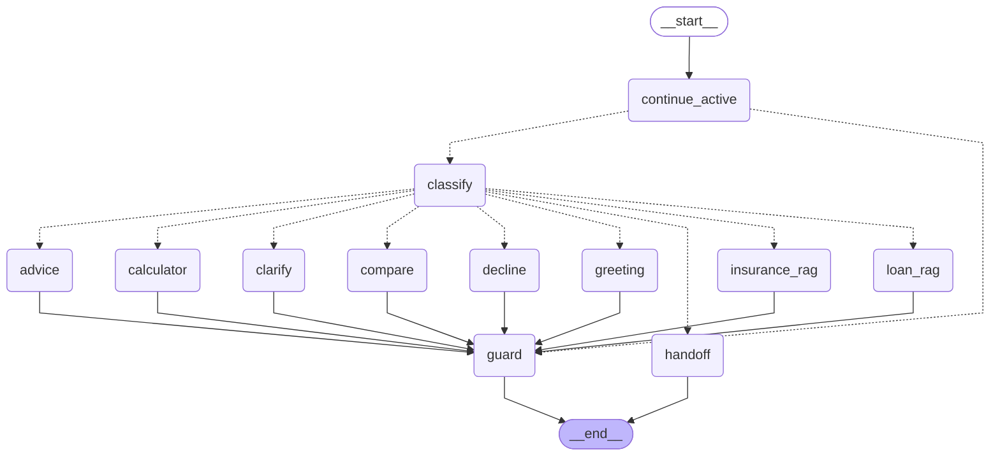

> A real report generated by `GET /audit/report/{session}?format=md` from a test conversation with synthetic speech. Nothing here is a real customer.

# Sahaj workflow report

## Overview

Session `d3db766c5a2c481c9a560d938147e357`. Generated 2026-11-14 18:43:29.

| Measure | Value |
|---|---|
| Turns | 7 |
| Started | 2026-11-14 18:36:57 |
| Duration (s) | 27.1 |
| Languages | en-IN (7) |
| Handed to a person | user_requested |
| Errors | 0 |
| Turns where personal details were withheld | 1 |

## Intent classification

What the classifier decided each turn wanted. Turns inside an active conversation are read by that conversation first and need no classifier call.

| Intent | Turns |
|---|---|
| greeting | 1 |
| insurance_explain | 1 |
| loan_calculator | 1 |
| loan_rates_comparison | 1 |
| loan_guidance | 1 |
| out_of_scope | 1 |
| human_handoff | 1 |
| **mean confidence** | 0.96 |
| decided by the classifier | 7 |
| decided by an active conversation | 0 |
| low confidence (asked the user to clarify) | 0 |
| asked for more detail | 0 |

## Routing through the orchestrator graph

| Path | Turns |
|---|---|
| continue_active > classify > decline > guard | 2 |
| continue_active > classify > greeting > guard | 1 |
| continue_active > classify > insurance_rag > guard | 1 |
| continue_active > classify > calculator > guard | 1 |
| continue_active > classify > loan_rag > guard | 1 |
| continue_active > classify > handoff | 1 |

## Latency

Decision time: from the transcript arriving to the verified reply. Speech recognition and speech synthesis are not included.

| Step | Calls | Mean ms | p50 ms | p95 ms | Max ms |
|---|---|---|---|---|---|
| **whole decision** | 7 | 849.9 | 590.0 | 1,448.0 | 1,448.0 |
| node: calculator | 1 | 828.1 | 828.1 | 828.1 | 828.1 |
| node: classify | 7 | 358.0 | 330.3 | 514.5 | 514.5 |
| node: continue_active | 7 | 0.0 | 0.0 | 0.0 | 0.0 |
| node: decline | 2 | 0.1 | 0.0 | 0.1 | 0.1 |
| node: greeting | 1 | 271.9 | 271.9 | 271.9 | 271.9 |
| node: guard | 6 | 142.6 | 0.2 | 415.1 | 415.1 |
| node: handoff | 1 | 0.0 | 0.0 | 0.0 | 0.0 |
| node: insurance_rag | 1 | 859.4 | 859.4 | 859.4 | 859.4 |
| node: loan_rag | 1 | 569.5 | 569.5 | 569.5 | 569.5 |

## Model usage and prompt caching

17 model calls; 15,999 input and 668 output tokens. Sarvam's prompt cache served 12,032 input tokens (75.2%); 0 model calls were avoided by the app caches.

| Purpose | Calls | Input tokens | Cached tokens | Cached % | Output tokens | App-cache hits | Mean ms | p95 ms |
|---|---|---|---|---|---|---|---|---|
| answer | 4 | 2,532 | 512 | 20.2% | 255 | 0 | 425.2 | 607.1 |
| classify | 7 | 12,101 | 11,488 | 94.9% | 302 | 0 | 357.5 | 514.1 |
| extract | 1 | 253 | 0 | 0.0% | 101 | 0 | 450.0 | 450.0 |
| fact_check | 5 | 1,113 | 32 | 2.9% | 10 | 0 | 294.3 | 413.9 |

## App-level caches (in memory, never stored)

| Cache | Hits | Misses | Hit rate |
|---|---|---|---|
| embeddings | 0 | 4 | 0.0% |
| verified_answers | 0 | 2 | 0.0% |

## Answer quality and guardrails

| Measure | Value |
|---|---|
| Replies checked | 6 |
| Passed | 6 |
| Blocked (safe fallback used) | 0 |
| Fallback rate | 0.0% |
| Block reasons | - |
| Served from the verified-answer cache | 0 |

## Retrieval

| Measure | Value |
|---|---|
| Turns that searched the knowledge base | 2 |
| Mean clauses used | 4.0 |
| Mean best similarity | 0.894 |
| Turns where nothing relevant was found | 0 |

## Consent

| Purpose | Event | When |
|---|---|---|
| conversation | granted | 2026-11-14 18:36:57 |

## Turn by turn

| # | Intent | Conf. | Path | ms | Model calls | Cached tok. | Verdict | Transcript / reply |
|---|---|---|---|---|---|---|---|---|
| 1 | greeting | 0.95 | continue_active > classify > greeting > guard | 590.0 | 2 | 1,664 | pass | Hello. -> Welcome to Sahaj. I can explain insurance policies and loan offers, compare insurance plans, recommend insurance after asking about your needs, work out a loan EMI or the interest saved by prepaying, and connect you to a person. W |
| 2 | insurance_explain | 0.95 | continue_active > classify > insurance_rag > guard | 1,388.0 | 4 | 1,632 | pass | What does claim settlement ratio mean? -> The claim settlement ratio is the share of claims an insurer settled out of the claims it received in a period. [concepts-insurance-basics:4.3] |
| 3 | loan_calculator | 0.99 | continue_active > classify > calculator > guard | 1,448.0 | 4 | 1,920 | pass | [withheld: personal details] -> For a loan of Rs 5,00,000 at 11 percent a year over 36 months the monthly instalment (EMI) is Rs 16,369 [calc:emi]. The total repayment is Rs 5,89,297 [calc:emi]. The total interest is Rs 89,297 [calc:emi]. T |
| 4 | loan_rates_comparison | 0.95 | continue_active > classify > decline > guard | 337.0 | 1 | 1,632 | pass | Which bank has the lowest home loan rate? -> I don't have current interest rates from banks, so I can't compare lenders or say whether a loan will be approved. I can explain what your loan offer says, work out an EMI, or connect you to a pe |
| 5 | loan_guidance | 0.95 | continue_active > classify > loan_rag > guard | 1,338.0 | 4 | 1,920 | pass | How can I get my loan application processed faster? -> Applications are usually slower when documents are missing or unclear, when details differ between documents, when the credit history shows past missed payments, or when the lender need |
| 6 | out_of_scope | 0.95 | continue_active > classify > decline > guard | 521.0 | 1 | 1,632 | pass | Tell me a joke. -> I can only help with insurance and loans. I can explain policies, compare and recommend insurance plans, explain a loan offer or work out an EMI, or connect you to a person. |
| 7 | human_handoff | 0.99 | continue_active > classify > handoff | 327.0 | 1 | 1,632 | - | I want to talk to a person. ->  |
