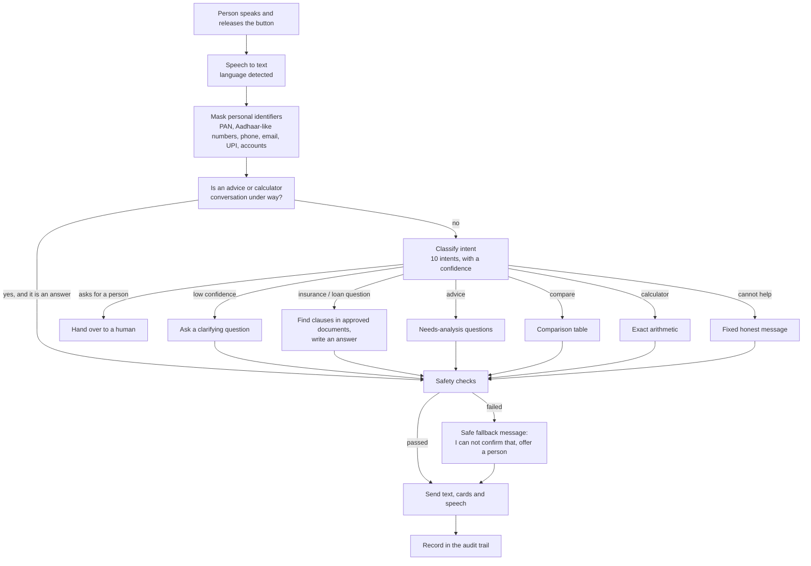

# Sahaj: the user journey and how the application flows

This document describes Sahaj from the person's point of view first, then explains what happens behind each step. It is written for product, compliance, design and engineering readers alike. Where something is not built yet, it says so.

> **Sample data.** Every insurance plan, premium and loan offer in Sahaj today is **fictional sample data** (every plan name carries "(SAMPLE)"). The flows below are real; the products are placeholders until real insurer and lender data replaces them.

## 0. Who Sahaj is for

**Primary persona — Asha, a first-time digital borrower and family decision-maker.** Asha lives in India, prefers Hindi or Hinglish, wants to understand health cover for her family and may need a personal loan. She has an offer letter, bank statement or policy document as a PDF/photo, but does not know which numbers matter. She wants the assistant to explain terms in plain language, compare only relevant options, calculate repayments, and help submit a request after she reviews the actual terms. She needs clear consent prompts, a human option, and no promise that a score guarantees approval.

**Supporting persona — Sahaj service executive.** The executive receives cases that need a person, can read the masked conversation summary, answer the customer, and schedule a video KYC appointment when the customer has opted in. The regulated lender's authorised official conducts V-CIP. The executive cannot see another customer's private document inventory.

**System persona — authorised financial provider.** A separately installed credit-bureau, lender or insurer adapter returns the real score, offer, quote or application status. There are no provider adapters configured in this checkout, so action endpoints return `503 provider_unavailable` until those partnerships and credentials are in place. Sample catalogue data must never be presented as a live quote or offer.

---

## 1. What Sahaj is

Sahaj is a **voice assistant for insurance and loans in India**. A person talks to it in their own language, and it talks back. It can:

| For insurance | For loans |
|---|---|
| Explain what a policy term means (waiting periods, exclusions, premiums, claims) | Explain what a loan offer says (fees, interest rate, prepayment, how to complain) |
| Explain the difference between kinds of insurance (for example term and whole life) | Work out an EMI, or the interest saved by paying part of a loan early |
| Compare plans side by side | Explain in general how loans work, and the kinds of loans |
| **Recommend plans**, but only after asking about the person's needs and confirming them | Say honestly when it *cannot* help (for example comparing banks' rates) |

At any point the person can **ask for a human**.

Sahaj is built to be trustworthy before it is clever: it answers only from approved documents, never invents a number, asks permission before using personal details, and keeps an audit trail.

---

## 2. The big picture

```
   Person                 Sahaj backend                                 Outside services
 ┌────────┐         ┌──────────────────────────────────────────┐
 │  App   │  voice  │  1. Hear      speech → text   ───────────┼──►  Sarvam (speech to text)
 │ (mic + │ ──────► │  2. Protect   mask personal identifiers  │
 │speaker)│         │  3. Decide    work out what they want    │
 │        │         │  4. Answer    find the right documents,  │──►  Sarvam (language model)
 │        │ ◄────── │               write a reply              │
 │        │  voice  │  5. Check     is every claim backed up?  │
 │        │  + cards│  6. Speak     text → speech   ───────────┼──►  Sarvam (text to speech)
 └────────┘         │  7. Record    audit trail (no personal   │
                    │               answers)                   │
                    └───────┬──────────────────────┬───────────┘
                            │                      │
                     Postgres + pgvector      Audit ledger
                     (approved documents)     (consent, turns, handoffs)
```

Voice clients use a **WebSocket** connection. Typed clients can use the text-only `POST /chat/stream` Server-Sent Events endpoint. The current test console's microphone is push-to-talk; the backend also has a streaming voice protocol for clients that implement speech-boundary detection. Sahaj replies with text, sometimes a card (a table or recommendation), and optional speech.

---

## 3. A person's journey, step by step

### Step 1: Opening the app

The person signs in, chooses a language and connects. Sahaj creates a **session**, a private conversation with its own reference number. No chat or voice is processed before the required conversation consent.

### Step 2: Giving permission to talk

Before Sahaj listens to anything, the person sees a short consent message and must tap **agree**. It says, in plain words, that Sahaj will process their voice and what they share to answer questions, that personal identifiers like PAN and Aadhaar are masked, that a record is kept for audit, and that they can withdraw at any time.

- **Agree:** the conversation starts.
- **Decline:** nothing is processed. They can change their mind later.

Every consent is written to a tamper-evident ledger with the exact wording they saw.

### Step 3: Talking

The person can type a message or, in a voice client, speak and send it. They see what Sahaj heard (for voice, the transcript) and then Sahaj's reply, which can also be spoken aloud. Answers about policies and loans include **source IDs** (like `[concepts-insurance-basics:4.3]`) and source text so the answer can be traced to a specific clause. Source IDs are never read aloud.

### Step 4: Getting what they came for

What happens next depends on what they ask. The sections below follow the main journeys.

### Step 5: Finishing or getting a person

They can close the app, withdraw consent, or ask for a human at any time (section 4.8).

---

## 4. The main journeys

### 4.1 "What does this mean?" (explaining insurance)

> *"What is the difference between term insurance and whole life insurance?"*
> *"What is the waiting period for pre-existing diseases?"*

Sahaj finds the relevant clauses in its approved documents, writes a short answer in the person's language, and cites the clause. If the question is about a **named plan** ("the Lotus plan"), it only looks at that plan's wording. If **no plan is named**, it answers only from the general explanations, so it never presents one plan's figures as if they were general. After a comparison or recommendation, "the first one" means those plans.

If the documents do not contain the answer, Sahaj says so and offers a person. It does not guess.

### 4.2 "Compare these plans"

> *"Compare the Lotus plan and the Neem plan."*

The screen shows a **comparison table** built from the plan data (waiting periods, co-payment, room rent, maternity, claim settlement ratio and so on), and Sahaj narrates the main differences. If the person has already given their details (see 4.3), the table also shows an indicative premium for each plan.

### 4.3 "Which plan should I buy?" (the recommendation journey)

This is the most careful journey. Sahaj will not recommend anything until it has **understood the person and they have confirmed it**.

```
 Ask for advice
      │
      ▼
 Permission to use personal details  ──decline──►  Sahaj keeps explaining and comparing,
      │ agree                                      but asks nothing personal
      ▼
 Questions, one at a time  ◄──────────────┐
      │                                    │ correction: "no, three children"
      ▼                                    │
 Read-back of everything understood ───────┘
      │ person says "yes, that is correct"
      ▼
 Recommendation + disclosures
```

**The permission.** A second consent covers using their age, income, family and existing cover. It says exact details are kept only during the conversation and that what they say in answer to the questions is not kept.

**The questions.** Sahaj asks one question per turn, in their language. For health insurance it asks about: which person is eldest, yearly income, the city, who is to be covered, how many children, existing health insurance, any existing medical condition, maternity cover, and what matters most (lowest price, reliable claims, shorter waiting periods, or nothing in particular). For life insurance: age, income, dependents, existing life cover, loans owed, whether they smoke, and what matters most. A person can answer several things at once ("I'm 34 and earn about 12 lakh"), and Sahaj only asks for what is still missing.

**Every answer is double-checked.** Sahaj never assumes. A figure is accepted only if it matches the person's own words, so "12 lakh" can never silently become 12 crore. A yes/no is accepted only for the question just asked.

**The read-back.** Sahaj reads back everything it understood, and the screen shows the **complete list**. The person must say yes. If they correct something, Sahaj updates it and asks again. A recommendation is impossible until this step is confirmed. This is enforced in code and tested.

**The recommendation.** Sahaj suggests an amount of cover (and shows how it was worked out), then up to **three ranked plans**, never just one "best". Each shows its premium, highlights, why it ranks where it does, and a score for each criterion. The ranking is calculated by fixed rules, not by the language model, so the same details always give the same answer. A need for maternity cover, for example, removes plans without it, and Sahaj says how many plans matched.

**The disclosures.** Fixed wording is shown with every recommendation: the suggestions rest only on the information given, premiums are indicative, read the policy wording before buying, plans are ranked only on the criteria shown, and a person is available. The first two are also spoken.

**If the person gets stuck.** After three turns of making no progress, Sahaj offers a person instead of looping.

### 4.4 "Explain my loan offer"

> *"What is the processing fee on my loan?"* · *"Can I repay early without a penalty?"* · *"Who do I complain to?"*

Sahaj answers from the lender's Key Facts Statement (KFS) and cites the clause, exactly as for insurance.

### 4.5 "Work out my EMI"

> *"What would the EMI be on 5 lakh at 11 percent for 3 years?"*
> *"If I prepay 1 lakh, how much interest do I save?"*

Sahaj asks only for the numbers it is missing (amount, yearly rate, time left, extra payment). The **arithmetic is done by code, never by the model**, and shown on a card. The answer notes that a lender's own figure can differ slightly.

### 4.6 "How do loans work?"

> *"What is the difference between a personal loan and a home loan?"* · *"How can I get my application processed faster?"*

Answered from a general loan explanation document, with citations.

### 4.7 Things Sahaj says it cannot do

- *"Which bank has the lowest home loan rate?"*, *"Will my loan get approved?"* → Sahaj has no bank rate data and cannot predict approval. It says so and offers to explain their offer, work out an EMI, or connect a person.
- Anything unrelated (jokes, general knowledge, medical or tax questions, or an instruction to ignore its rules) → a fixed polite message that it only helps with insurance and loans.

These replies are written text, not generated, so an instruction hidden in a message cannot talk Sahaj into anything.

### 4.8 Getting a person

A person can ask for a human in four ways, and the conversation is **handed over**:

| How | What triggers it |
|---|---|
| They tap **Talk to a human** | A button at any time |
| They say so | "I want to talk to a person", a complaint, or clear frustration. This is never second-guessed. |
| Sahaj cannot verify its own answers | Two replies in a row fail the safety checks |
| They are stuck | Three turns of the questions without progress |

On handover the screen shows a **reference number**. Sahaj stops answering. A summary (recent messages with personal answers replaced by a placeholder, which permissions are active, and the trace id) is recorded and sent to the human team's system. *The live console for the human to reply is not built yet.*

### 4.9 Changing their mind: withdrawing consent

They can withdraw either permission at any time. Withdrawing the **personal-details permission** wipes the analysis; asking for advice again asks permission again. Withdrawing the **conversation permission** also clears the conversation memory.

### 4.10 When it does not understand

- **Silence or noise:** "I didn't catch that."
- **A vague message** ("what about that one?"): Sahaj asks a clarifying question instead of guessing.
- **A message in the middle of the questions that is a question itself** ("what is a waiting period?"): Sahaj answers it, and the questions can continue.

### 4.11 Buy an insurance policy

1. Asha describes who needs cover and what matters. Sahaj asks the needs-analysis questions, reads back the details and waits for confirmation before making a recommendation.
2. Sahaj can explain and compare the catalogue. In this checkout the catalogue is sample data; it must not be treated as an insurer quote.
3. For a real purchase, the backend lists configured insurers, requests a quote for Asha's confirmed details, and shows the insurer, premium, payment frequency and policy wording/version returned by that provider.
4. Asha reviews the wording and explicitly confirms the selected quote and terms version. Only then does Sahaj submit the purchase request. The insurer/provider handles payment and policy issuance through its approved checkout flow.
5. The application status is shown from the provider response and remains available in Asha's own financial event list. Sahaj never tells her a policy is issued unless the insurer says so.

The REST path is `POST /financial/insurance/quotes` followed by `POST /financial/insurance/purchase`; both are authenticated and consent-gated. No insurer adapter is configured now, so the live quote/purchase requests return `503 provider_unavailable` instead of fake data.

### 4.12 Apply for a loan with a real credit check

1. Asha first asks questions, uploads a Key Facts Statement if she has one, and uses Sahaj's EMI calculator to understand the payment. This estimate is not a lender quote.
2. To request a bureau check, Sahaj names the selected authorised provider, displays the current `credit_bureau` consent, and asks for explicit confirmation before sending identity fields. A CIBIL score comes from TransUnion CIBIL through an authorised adapter; Sahaj does not calculate a score from income, PAN or chat history.
3. If the provider returns a usable check, Asha chooses a requested amount, tenure and purpose. Sahaj asks an installed lender adapter for current offers and presents the lender's terms and Key Facts Statement. It does not predict approval.
4. Asha reviews the KFS and enters only the application fields the lender requires. Sahaj submits only after she accepts the exact KFS version and confirms the application.
5. The lender returns the application status and remains responsible for the credit decision. If that lender requires video KYC, Asha separately grants the versioned video-KYC consent and requests an appointment. The executive desk books a time and HTTPS meeting URL. The authorised official of the regulated lender must conduct the V-CIP; Sahaj currently provides case creation and scheduling only.

The REST path is `POST /financial/credit-check` → `POST /financial/loan/offers` → user reviews offer/KFS → `POST /financial/loan/apply`. Loan offers require a recent check from the same provider. With no credit-bureau or lender adapter configured now, these live steps return `503 provider_unavailable` and no credit data is fabricated.

### 4.13 Upload and find a personal document

1. Asha opens her own document inventory with `GET /files`. The API returns only her file metadata and consent states.
2. After seeing and granting `documents` consent, she uploads one file per `multipart/form-data` request to `POST /files`. The backend accepts PDF, PNG, JPEG, WebP, GIF, DOCX, XLSX, PPTX, UTF-8 text and supported audio within the API's returned size/file limits.
3. A separate `document_analysis` consent allows indexing and questions. PDF text, office files and UTF-8 text are parsed locally; scanned PDFs and PNG/JPEG images use OCR. WebP, GIF and audio can be stored but are not indexed for document question-answering.
4. She polls `GET /files` until that item is `ready`, then asks a question in chat. Matching passages are cited as `mydoc-*`; personal passages are not cached or shared. `GET /files/{id}` and `DELETE /files/{id}` are owner-checked, so another person's ID returns `404`.
5. Withdrawing `document_analysis` removes extracted passages while leaving the files. Withdrawing `documents` deletes the stored files too. S3 is private and the API returns no public object URLs.

### 4.14 Ask for current public information

If the local policy/KFS documents do not contain an answer about publicly available insurance or lender information, Sahaj can use `POST /search/web` with the `insurance` or `loan` domain. The answer's `web:*` source entries include title and URL alongside page text. It must label this as public research; the result is not an application-specific quote, eligibility check or approval. The `FIRECRAWL_API_KEY` feature must be configured.

### 4.15 See a source behind an answer

Each assistant response includes `structured.points[].sources` and `structured.sources[]` (`id`, `text`). The text is the exact clause or web result passage used by the answer. A text client should resolve each point's source IDs against `structured.sources` and show the matching text; the top-level `citations` field is a compatibility copy of that same list. The backend also keeps source IDs visible when the fact-check passed over retrieved evidence but the model omitted inline tags, and carries summary-only sources onto the first body point. Blocked safe replies have no source chips. Sources are returned with the answer, so no separate source fetch is needed.

---

## 5. Inside one turn: what happens in the few seconds after they speak



In words:

1. **Hear.** Their speech is turned into text and the language is detected (English, Hindi, Hinglish and other Indian languages).
2. **Protect.** Personal identifiers are replaced with placeholders such as `[PAN_1]` before anything else sees the text. This includes identifiers the speech recogniser spells out letter by letter, and digits written in Indian scripts.
3. **Decide.** If a recommendation or loan calculation is already under way, that conversation reads the message first, because a short reply like "34" is almost certainly an answer to the last question. Otherwise a classifier decides what they want, with a confidence.
4. **Answer.** The right specialist handles it. For insurance and loan questions this means searching approved documents by meaning (not keywords), so a Hindi question can find an English clause, and writing a short reply from only those clauses.
5. **Check.** See section 6. Nothing reaches the person without passing.
6. **Speak.** The reply is turned into speech in the person's language (see section 8) and sent with any card.
7. **Record.** The turn is saved to the audit trail (section 7).

Repeated, non-personal questions are served from a short-lived in-memory cache of answers that already passed the checks, which makes them near-instant. Nothing personal is ever cached.

---

## 6. The safety checks every reply passes

| Check | In plain words |
|---|---|
| **Backed by a clause** | Every statement must carry a source tag for a clause that was actually retrieved |
| **Numbers must match** | Any figure in a reply must appear in the clause it cites. A computed or invented number is blocked |
| **Nothing added** | A second check asks whether the reply adds any condition, exception or reason the documents do not state |
| **On the point** | A third check asks whether the reply actually answers the question, so a true but irrelevant clause is not offered as an answer |
| **No advice outside the advice journey** | Phrases like "I recommend" are blocked everywhere except in text built from the recommendation engine. Pressure phrases ("you must buy", "guaranteed", "limited time") are blocked everywhere |
| **Personal details masked** | The model's reply is masked again on the way out |

If a reply fails, the person hears: *"I can't confirm that from the documents I have. Would you like me to connect you to a person?"* Two failures in a row hand over to a human. The checks are strict on purpose, so occasionally a correct answer is replaced by this message. That is the safe direction.

---

## 7. What Sahaj records, and what it deliberately does not

**Recorded in the audit trail** (a tamper-evident, append-only ledger):

- every consent, with the version and a fingerprint of the exact wording shown;
- each turn: what was masked of what they said, what Sahaj decided they wanted, the route taken, the clauses used, the check results, and timings;
- each handover, with its reason;
- each recommendation, using **ranges** (for example "age 30 to 34", "income 10 to 15 lakh"), the rules version, the catalogue version, and the score breakdown.

**Deliberately not recorded:**

- the person's exact answers to the needs-analysis questions (age, income, family, loans, health). Those turns are stored as "withheld", and in the conversation memory they are replaced by a placeholder;
- the read-back of their details;
- raw PAN, Aadhaar, phone, email, UPI or account numbers.

A team member can request a **workflow report** for any conversation (intents, routes, timings, cache use, check results, handovers, recommendations in ranges), and can verify that the ledger has not been altered.

---

## 8. Languages

Sahaj replies in the language the person spoke. Mixed speech such as Hinglish is answered in Hindi.

| Level | Languages | What the person gets |
|---|---|---|
| Full voice | English, Hindi, Bengali, Tamil, Telugu, Kannada, Marathi, Gujarati, Punjabi, Malayalam, Odia | Text and speech in a voice for that language |
| Spoken by a related voice | Nepali, Maithili, Dogri, Konkani, Sanskrit, Bodo (Hindi voice); Assamese (Bengali voice) | Text in their language; pronunciation is approximate |
| Text only | Urdu, Kashmiri, Sindhi, Santali, Manipuri | Text in their language, no audio |

Some fixed messages (the declines, the disclosures, the fallback line) exist in English and Hindi; other languages receive them via model phrasing or in English.

---

## 9. A sample conversation (health insurance)

Everything below is sample data. Sahaj's questions were generated live; figures come from the recommendation engine.

| | |
|---|---|
| **Person** | Which health insurance should I buy for my family? |
| **Screen** | *(permission request: use my age, income and family details)* → person agrees |
| **Sahaj** | Could you tell me the age of the eldest person who will be covered? |
| **Person** | I am 34 years old. |
| **Sahaj** | What is your approximate income per year? |
| **Person** | About 12 lakh a year. |
| **Sahaj** | Do you live in a large metro city, or in another city or town? |
| **Person** | I live in Bangalore. |
| **Sahaj** | Who is the cover for: yourself, you and a spouse, or a family with children? |
| **Person** | Me, my wife and our two kids. |
| **Sahaj** | Do you already have health insurance, and is it from an employer or your own? |
| **Person** | No, we don't have any. |
| **Sahaj** | Does anyone to be covered have an existing medical condition? |
| **Person** | No. |
| **Sahaj** | Would you like maternity expenses covered? |
| **Person** | Yes, we would like maternity cover. |
| **Sahaj** | Does anything matter most to you, such as the lowest price? |
| **Person** | The lowest premium matters most. |
| **Screen** | *Details card:* health insurance · age 34 (eldest) · income Rs 12,00,000 · metro city · family with 2 children · no existing health insurance · no existing medical condition · wants maternity cover · priority: low premium |
| **Sahaj** | *(reads the details back)* Is that right, or should anything change? |
| **Person** | Yes, that is correct. |
| **Screen** | *Recommendation card:* suggested cover Rs 20,00,000 and how it was worked out; the plan that matched (the only one with maternity cover), its indicative yearly premium, why it ranks there and its score breakdown; all five disclosures |
| **Sahaj** | *(speaks)* The suggested cover is Rs 20 lakh. The plan that matched is ... One of the 3 plans in the catalogue matched on age and maternity cover. The full details are shown on the screen. These suggestions are based only on the information you gave me, and nothing else. Premiums shown are indicative... |

---

## 10. What is built, and what is not yet

**Backend capabilities in this checkout:** sign-in and versioned consent; personal-detail masking; source-grounded document search; owner-scoped file inventory, upload, download and deletion; PDF, image, office and text extraction after document-analysis consent; Firecrawl search; chat and calculators; generic credit-bureau, lender and insurer adapter interfaces; financial action endpoints; customer/executive support cases and video-KYC scheduling.

**Not ready for production use:**

| Missing | Why it matters |
|---|---|
| **Real plans and real lender documents** | Everything is sample data until supplied |
| **Live products and partners** | Catalogue data is fictional, and no authorised lender, insurer or CIBIL adapter is configured; financial actions return `503 provider_unavailable` |
| **Video KYC session and identity decision** | Case creation, consent, and human appointment scheduling are exposed; the call itself and verification need a V-CIP provider/process and an authorised human |
| **Payment processing and policy issuance** | Purchase submission and HTTPS checkout handoff are adapter capabilities; no payment/insurer adapter is configured |
| **Provider KFS and policy delivery** | The API records acceptance of a provider-supplied KFS/policy version; there is no live provider to supply those documents yet |
| **Data deletion on request, retention rules, grievance register** | Needed for RBI and data-protection compliance |
| **Human operation at scale** | Case APIs and executive WebSocket exist; team staffing, operational processes and service levels need configuration |
| **Hands-free speech in the test console** | The backend supports a streaming voice protocol; client-side speech-boundary detection is required, and the test console remains push-to-talk |
| **IRDAI advice rules mapped** | The recommendation feature is built, but the regulatory mapping is an open item |

See `docs/compliance.md` for the regulatory detail and `docs/orchestration.md` for the technical design.

---

## 11. Glossary

| Term | Meaning |
|---|---|
| **Session** | One conversation with its own reference number and permissions |
| **Intent** | What a message is asking for (explain, advise, compare, calculate, ...) |
| **Needs analysis** | The questions Sahaj asks before recommending, followed by the read-back |
| **Clause** | One numbered section of an approved document, the unit Sahaj cites |
| **Card** | Structured data the app displays (details, recommendation, comparison, loan calculation) |
| **Handover (handoff)** | Passing the conversation to a human, with a reference number |
| **KFS** | Key Facts Statement: a lender's plain-language summary of a loan's main terms |
| **EMI** | Equated monthly instalment: the fixed monthly repayment of a loan |
| **Audit ledger** | The tamper-evident record of consents, turns, handovers and recommendations |
| **Masking** | Replacing personal identifiers with placeholders before anything else sees them |
